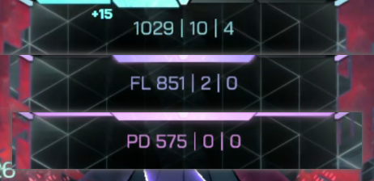

# PD/FL Indicator

## 中文

**版本：1.0.0 · 作者：Ghomist · 适配：Windows x64 / In Falsus（BepInEx 6 IL2CPP）**

在游戏中，于顶部回忆值条下方实时显示当前是否仍保持 **PD（PERFECT DIVE）/ FL（FULL LINK）**，以及 EXACT / NEAR / BREAK 计数。

本项目为非官方工具，与 lowiro 无隶属或背书关系。安装包只包含模组 DLL 与说明，不包含任何游戏文件。

### 功能

- **PD / FL 状态**：没有 NEAR 和 BREAK 时显示 `PD`；出现 NEAR 但没有 BREAK 时显示 `FL`；出现 BREAK 后状态文字消失，只保留计数。
- **判定计数**：EXACT（含大 / 小 EXACT 分开统计）、NEAR、BREAK。
- **颜色跟随状态**：PD 为 PERFECT DIVE 粉紫，FL 为 FULL LINK 淡蓝紫，BREAK 后为 DIVE CLEARED 青色，均可自定义。
- **使用游戏自身文字渲染**：复用游戏的 FastText 字体与材质，风格与游戏界面一致。
- **不修改游戏界面**：文字是独立对象，不挂在游戏 UI 下，不改动回忆值条或其他游戏元素；只读判定数据，不影响成绩保存。
- **Hold 抖动过滤**：Hold 判定中途会短暂出现 NEAR 中间态，模组要求 NEAR / BREAK 持续一段时间（默认 0.35 秒）才计入，避免误报 FL。

### 安装

**模组管理器（推荐）**：在 r2modman / Thunderstore Mod Manager 中选择 In Falsus，搜索并安装 *PD/FL Indicator*，BepInEx 会作为依赖自动安装。

**手动安装**：

1. 先为游戏安装 [BepInEx 6 IL2CPP x64](https://thunderstore.io/package/BepInEx/BepInExPack_IL2CPP/)，并启动一次游戏让其生成文件。
2. 将 `PdFlIndicator.dll` 放到 `BepInEx/plugins/PdFlIndicator/PdFlIndicator.dll`。
3. 正常启动游戏，进入歌曲即可看到显示。

### 配置

配置文件：`BepInEx/config/pdfl.indicator.cfg`（首次启动游戏后生成，修改后重启游戏生效）。

| 分组 | 项 | 默认值 | 说明 |
| --- | --- | --- | --- |
| General | `Enabled` | `true` | 是否显示 |
| Layout | `OffsetY` | `-0.35` | 相对回忆值条的垂直偏移，负值向下 |
| Layout | `TextScale` | `0.3` | 文字大小（相对游戏分数文字） |
| Color | `PdColor` | `#F09CFF` | PD 时文字颜色 |
| Color | `FlColor` | `#B3B5FF` | FL 时文字颜色 |
| Color | `ClearColor` | `#9CE8F7` | BREAK 后文字颜色 |
| Text | `Format` | `$s $e \| $n \| $b` | 显示格式，见下表 |
| Text | `PdText` / `FlText` | `PD` / `FL` | 状态文字 |
| Judgement | `StableSeconds` | `0.35` | NEAR / BREAK 需持续多久才计入（秒） |

颜色支持 `#RRGGBB` 或 `#RRGGBBAA`。

**格式变量**：

| 变量 | 含义 |
| --- | --- |
| `$s` | 状态：`PD` / `FL` / 空（BREAK 后） |
| `$e` | EXACT 总数 |
| `$be` | 大 EXACT 数 |
| `$se` | 小 EXACT 数 |
| `$n` | NEAR 数 |
| `$b` | BREAK 数 |
| `$$` | 输出一个 `$` |

例如 `$s $be/$se | $n | $b` 显示为 `PD 520/55 | 0 | 0`。

### 已知限制

- 计数是游戏当前已判定音符的实时统计；由于 Hold 过滤，NEAR / BREAK 计数会比实际判定晚约 `StableSeconds` 出现。
- 游戏大版本更新可能导致失效，请留意更新。

---

## English

**Version: 1.0.0 · Author: Ghomist · Supported: Windows x64 / In Falsus (BepInEx 6 IL2CPP)**

Shows, live during play, whether you are still on track for **PD (PERFECT DIVE) / FL (FULL LINK)**, plus EXACT / NEAR / BREAK counts, right under the recollection bar at the top of the screen.

This is an unofficial tool, not affiliated with or endorsed by lowiro. The package only contains the mod DLL and documentation.

### Features

- **PD / FL status**: `PD` while you have no NEAR and no BREAK; `FL` after a NEAR but no BREAK; the status text disappears after a BREAK, leaving only the counts.
- **Judgement counts**: EXACT (with big / small EXACT available separately), NEAR, BREAK.
- **State-colored text**: PERFECT DIVE pink-purple, FULL LINK lavender, DIVE CLEARED cyan after a BREAK; all configurable.
- **Native text rendering**: reuses the game's own FastText font and material, so it matches the game's UI.
- **Does not modify the game UI**: the label is a standalone object, not parented under game UI; the recollection bar and other elements are untouched. Judgement data is read-only and score saving is unaffected.
- **Hold jitter filter**: holds briefly report an intermediate NEAR state; NEAR / BREAK only count after persisting for a while (0.35 s by default), avoiding false FL.

### Installation

**Mod manager (recommended)**: in r2modman / Thunderstore Mod Manager, select In Falsus and install *PD/FL Indicator*; BepInEx is installed automatically as a dependency.

**Manual**:

1. Install [BepInEx 6 IL2CPP x64](https://thunderstore.io/package/BepInEx/BepInExPack_IL2CPP/) for the game and launch once.
2. Put `PdFlIndicator.dll` at `BepInEx/plugins/PdFlIndicator/PdFlIndicator.dll`.
3. Launch the game and start a song.

### Configuration

File: `BepInEx/config/pdfl.indicator.cfg` (generated on first launch; restart the game after editing).

| Section | Key | Default | Description |
| --- | --- | --- | --- |
| General | `Enabled` | `true` | Show the indicator |
| Layout | `OffsetY` | `-0.35` | Vertical offset from the recollection bar; negative is down |
| Layout | `TextScale` | `0.3` | Text size relative to the game's score text |
| Color | `PdColor` | `#F09CFF` | Text color while PD |
| Color | `FlColor` | `#B3B5FF` | Text color while FL |
| Color | `ClearColor` | `#9CE8F7` | Text color after a BREAK |
| Text | `Format` | `$s $e \| $n \| $b` | Display format, see below |
| Text | `PdText` / `FlText` | `PD` / `FL` | Status labels |
| Judgement | `StableSeconds` | `0.35` | How long NEAR / BREAK must persist to count (seconds) |

Colors accept `#RRGGBB` or `#RRGGBBAA`.

**Format variables**: `$s` status, `$e` total EXACT, `$be` big EXACT, `$se` small EXACT, `$n` NEAR, `$b` BREAK, `$$` a literal `$`.

Example: `$s $be/$se | $n | $b` → `PD 520/55 | 0 | 0`.

### Known limitations

- Counts reflect notes judged so far; because of the hold filter, NEAR / BREAK appear about `StableSeconds` late.
- Major game updates may break the mod.
